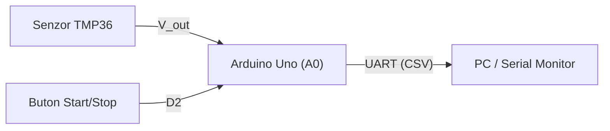

# Sistem de achizitie si monitorizare a temperaturii (APD)

Proiect de laborator pentru achizitia semnalelor analogice, filtrarea numerica si transmiterea datelor pe interfata seriala UART.

Specificatia comenzilor se gaseste aici: [Specificatia protocolului](docs/protocol.md)

## 1. Arhitectura sistemului



## 2. Alocarea pinilor (Pinout)

| Componenta | Pin Arduino | Configuratie | Rol |
| :--- | :---: | :---: | :--- |
| Senzor TMP36 | `A0` | Intrare analogica | Masurare temperatura |
| Buton control | `D2` | `INPUT_PULLUP` | Activare / oprire esantionare |
| LED Stare | `D13` | `OUTPUT` | Semnalizare achizitie activa |

## 3. Relatia de conversie

Pentru senzorul TMP36 ($500\text{ mV}$ offset la $0^\circ\text{C}$, panta $10\text{ mV}/^\circ\text{C}$), temperatura in grade Celsius se calculeaza cu relatia:

$$T(^\circ\text{C}) = \left( \frac{D_{ADC} \cdot 5.0}{1023.0} - 0.5 \right) \cdot 100$$

### Filtrarea numerica

Filtrul cu medie mobila face media aritmetica a ultimelor $M$ esantioane:

$$y[n] = \frac{1}{M} \sum_{k=0}^{M-1} x[n-k]$$

Implementare in C++:

```cpp
const int M = 8;
int x[M];
long suma = 0;

for (int k = 0; k < M; k++) {
  x[k] = analogRead(A0);
  suma += x[k];
}

float y = (float)suma / M;
```

## 4. Formatul datelor transmise (CSV)

```text
timestamp_ms,raw_adc,voltage_v,temp_c
1000,153,0.75,24.78
2000,155,0.76,25.76
```

## 5. Checklist verificare

- [x] Configurare repository si `.gitignore`
- [x] Redactare specificatie hardware in Markdown
- [ ] Simulare circuit in Tinkercad Circuits
