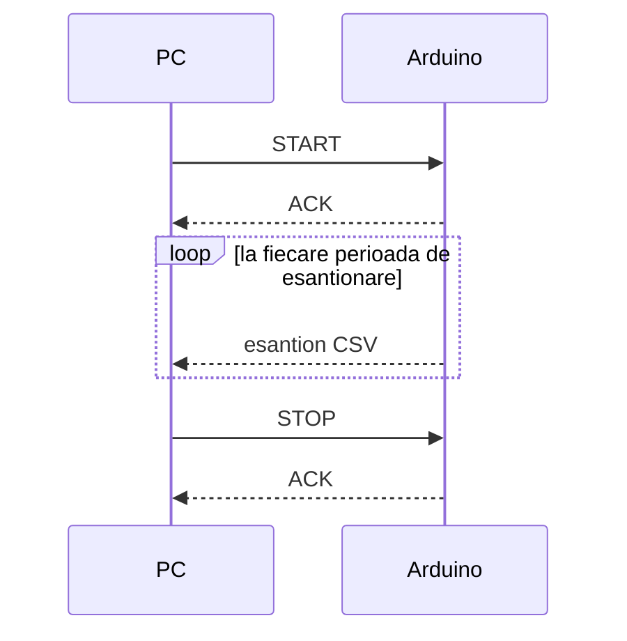
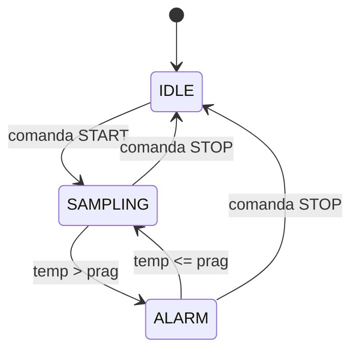

# Protocolul de comunicatie PC - Arduino

Aici e descris cum comunica PC-ul cu placa Arduino pe portul serial (9600 bps).

## 1. Schimbul de mesaje

## 2. Comenzi suportate

| Comanda | Cod | Efect |
| :--- | :---: | :--- |
| `START` | `0x01` | Porneste achizitia, Arduino raspunde cu ACK si apoi trimite esantioane |
| `STOP` | `0x02` | Opreste achizitia si raspunde cu ACK |
| `STATUS` | `0x03` | Arduino raspunde cu starea curenta (IDLE, SAMPLING sau ALARM) |

## 3. Automatul de achizitie

